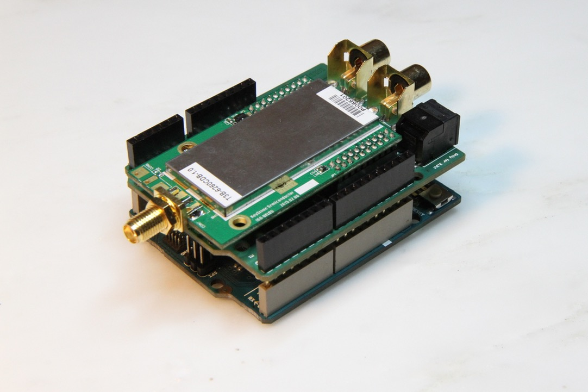
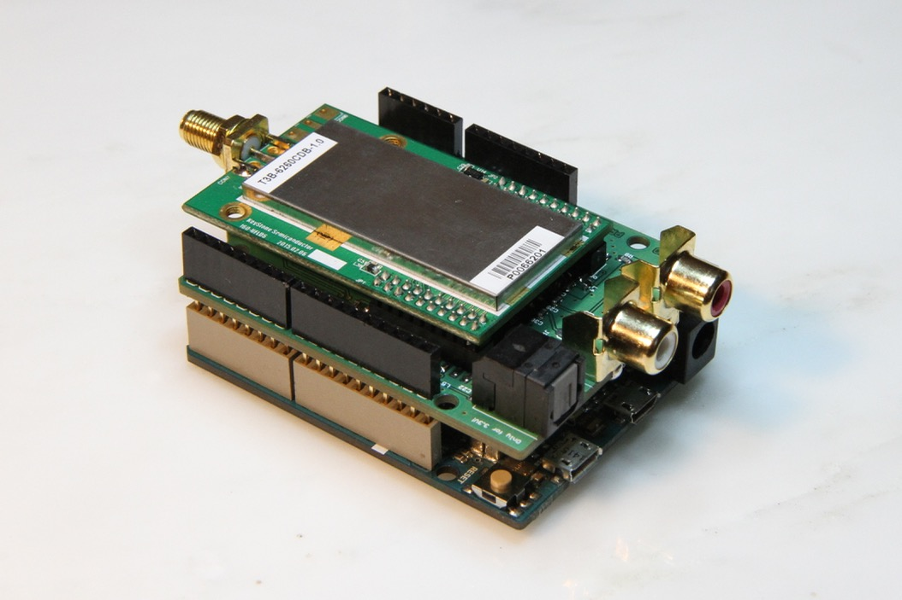
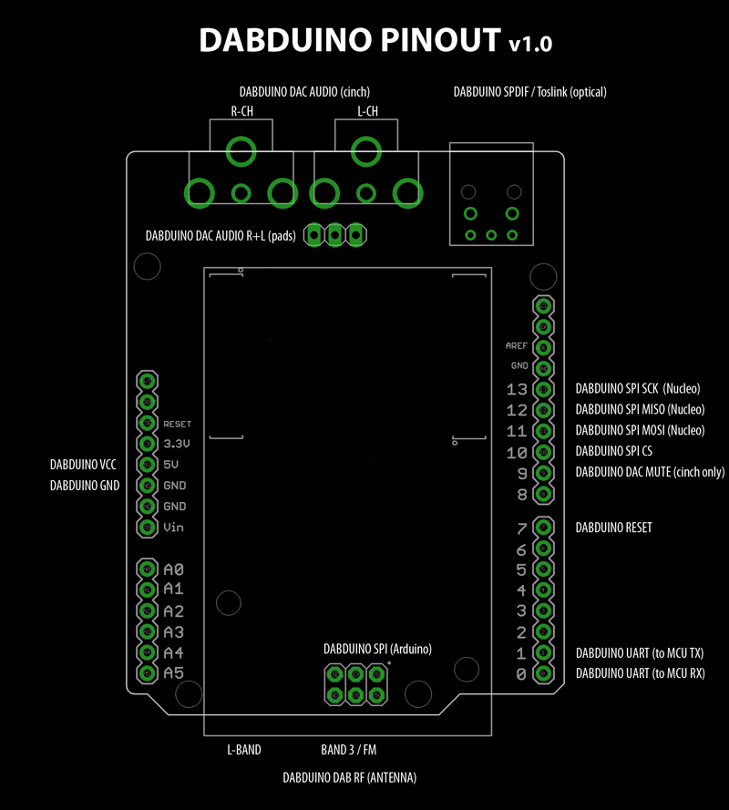

## A new DABDUINO is coming

DABDUINO comes back. We develop a new DABDUINO: a complete DAB+, FM and
internet radio board for makers, with an ESP32-S3 microcontroller on the
board. It plays without other boards, and other microcontroller boards can
also control it. These are the planned functions:

**Radio**

* DAB, DAB+ and FM with RDS
* Station names and text information (DLS), and station pictures (slideshow)
  on a display
* Internet radio through Wi-Fi (MP3 and AAC streams)

**Control**

* From your phone or from a web browser through Wi-Fi, with a web interface
  in the firmware
* From your phone through Bluetooth LE (control only, no audio)
* From a smart home system, for example Home Assistant (MQTT), also as a
  player for the audio of Home Assistant
* Headers for a display, a rotary encoder, buttons and an IR receiver for a
  remote control
* Clock and alarm, with the time from DAB or from the internet

**Sound**

* Line output and an optical SPDIF (Toslink) output
* An expansion connector for audio modules: you select a headphone amplifier
  or a speaker amplifier for your project, to your preferences
* Or a Bluetooth module on the same connector, which sends the audio to
  Bluetooth headphones and speakers

**Power**

* USB-C, a DC input from 5 V to 16 V, or the supply of the host board

**For makers**

* Write your own firmware for the ESP32-S3 with Arduino or ESP-IDF. An open
  source DABDUINO library controls the radio and the other parts of the
  board.
* Or use the board as a radio for Arduino, STM32, Raspberry Pi and other
  boards, through UART or I2C, with any logic voltage from 1.8 V to 5 V
* Firmware updates through Wi-Fi (OTA) or USB-C
* Open hardware and open source firmware. The firmware of the radio receiver
  is installed in the flash memory of the board.

Open source projects can add more functions.

The new DABDUINO is in development. Information and news:
https://www.dabduino.com

Tell us which functions you want: open an issue in this repository, or send
an email to turbyho@gmail.com.

The text below describes the original DABDUINO (2017).

## What is the DABDUINO?

The DABDUINO is good starting point for high quality DIY DAB/DAB+/FM home receiver project, car receiver or anything you want. Digital optical audio outout (Toslink) and 32-bit, 384kHz PCM DAC offers the same audio quality as expensive DAB/DAB+ receivers.

The DABDUINO is Arduino DAB/DAB+ (digital radio) + FM shield with 32-bit, 384kHz PCM DAC (cinch) + Toslink optical digital audio output. DABDUINO Library is designed specifically to work with the DABDUINO.

The library supports many functions for control DABDUINO and for access to broadcast data. For example - automatic station search and store stations in database, watching and reading DAB/DAB+ and FM station name, program type, information texts and data from DAB/DAB+/FM RDS, signal strength and quality, volume and stereo mode settings and many others. In near future I will add functions for access to media data from DAB/DAB+ stream. For example - images, etc. 

**Compatibility:**
* Arduino (as shield): DUE, ZERO, M0, M0 PRO
* Arduino (wired): MKRZero, MRK1000 

> _Generally all Arduino 3.3V boards (Arduino 5V boards only with level shifting)_

* STM32 (as shield): Nucleo L476RG, Nucleo F091RC, Nucleo F103RB
* STM32 (wired): STM32F103C8T6 

> _Generally all supported boards in [stm32duino](https://github.com/stm32duino/Arduino_Core_STM32) and [Arduino_STM32](https://github.com/rogerclarkmelbourne/Arduino_STM32)_

> _SPI is not needed for common operation (only for access to media data)_

**Bands:**
* DAB/DAB+: BAND III, CHINA BAND, L-BAND
* FM: 87.5 - 108MHz

**Input:**
* RF (antenna): SMA connector, solder pads

**Output:**
* Analog audio: 32-bit, 384kHz PCM DAC - stereo cinch (golden), solder pads
* Digital audio: Toslink (optical)

**Real Time Clock (RTC):**
* on board, synchronised from DAB/DAB+ stream 

**Power:**
* DABDUINO is powered only from Arduino pin heads. No need external power source. 

## How to connect (without pin headers)
Minimal wiring is ANTENNA (use correct band), TX, RX, (DABDUINO) RESET, GND, +5V.

## How to install
Open library manager in Arduino IDE and install the DABDUINO library.

## References
For command reference visit [DABDUINO.cpp](https://github.com/turbyho/DABDUINO/blob/master/src/DABDUINO.cpp). 
Example is available here [DABDUINO_example_1.ino](https://github.com/turbyho/DABDUINO/blob/master/examples/Dabduino_example_1/DABDUINO_example_1.ino).

## Where to buy the DABDUINO?
Currently unavailable 
<!-- DABDUINO is ready for dispatch. Price is 69 EUR. Postage for Europe 6 EUR, for rest of the world 10 EUR. Send me order by [email](mailto:turbyho@gmail.com) please.-->

Dabduino is dispatched without pin headers and SMA for easier installation in custom devices.

## Have some problem or questions?
Send me [email](mailto:turbyho@gmail.com) :)

## Final DABDUINO

### Second prototype video

### First prototype video

### Pinout

[Montyho technology s.r.o.](https://www.montyho.com)
